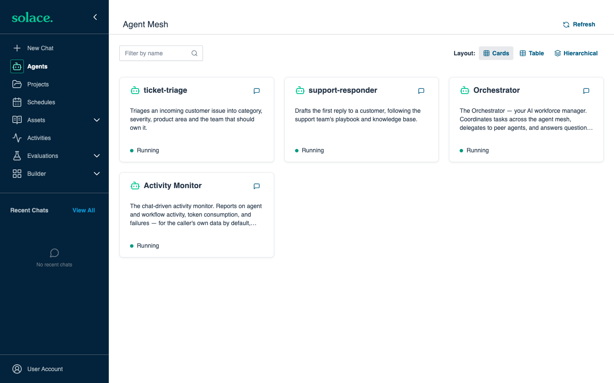
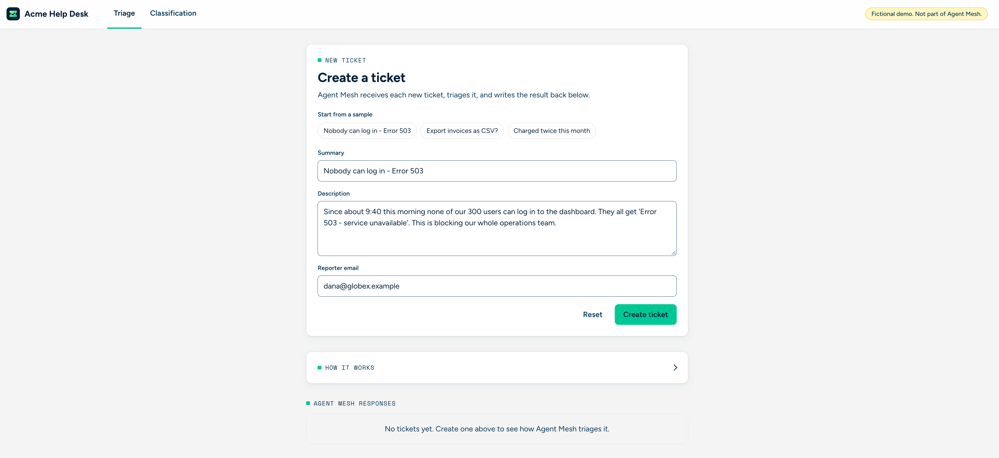
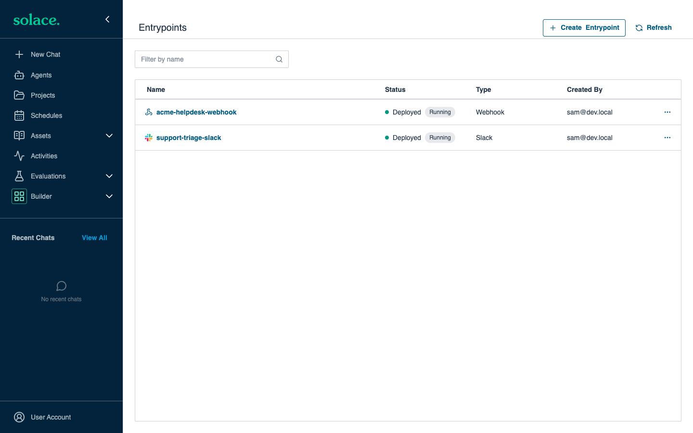
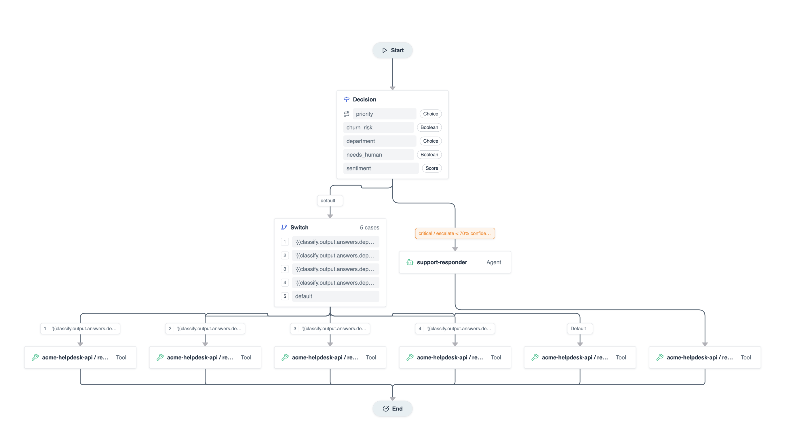
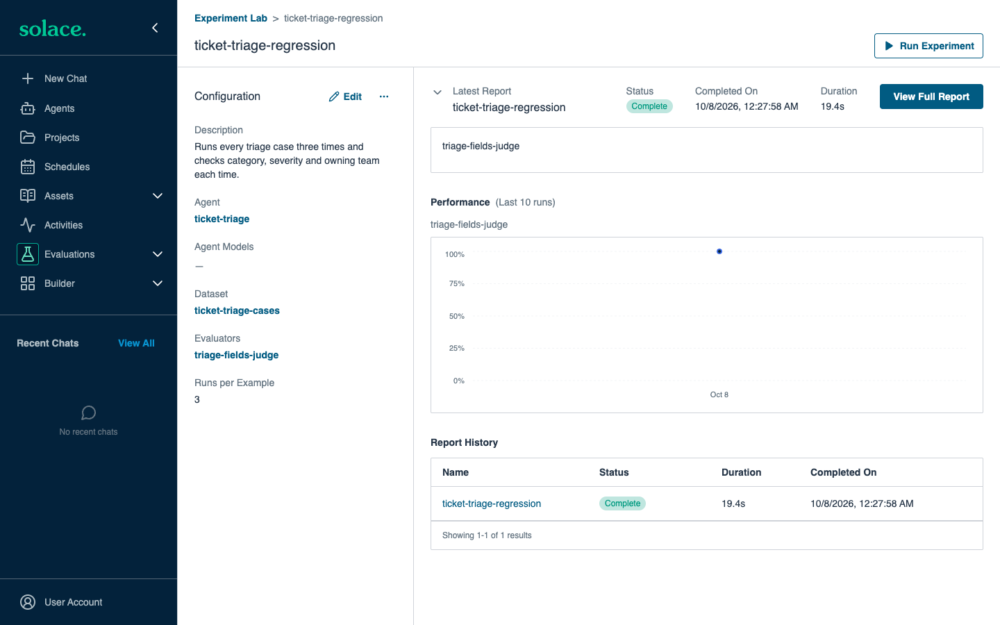
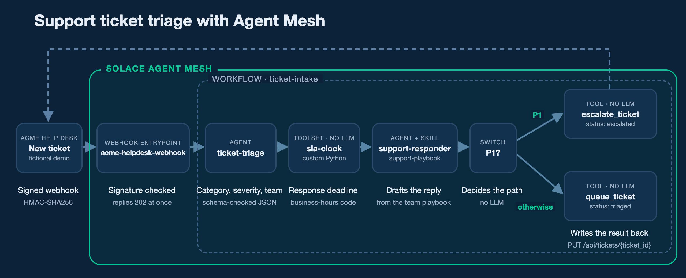
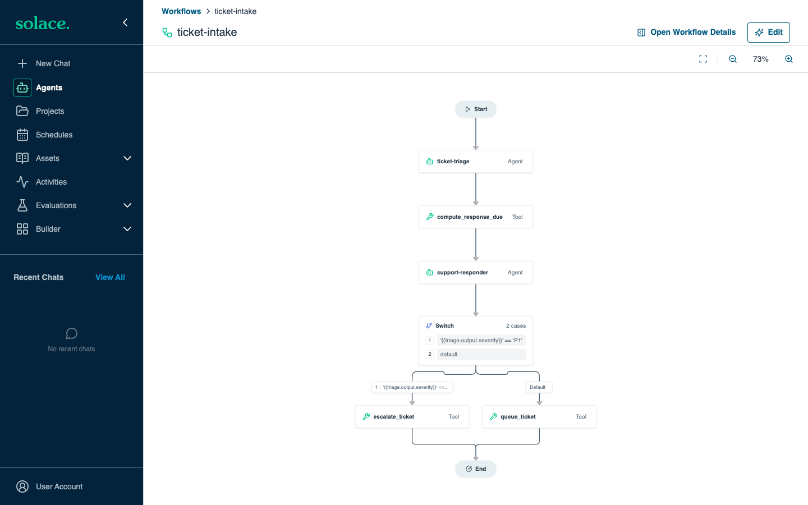
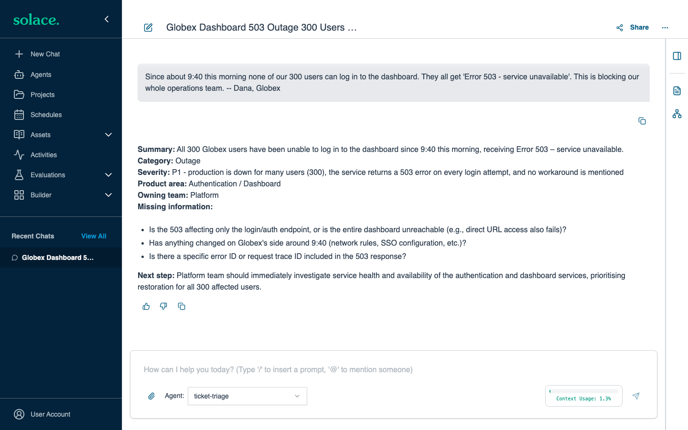

<!-- Copyright Solace Corporation -->
<!-- SPDX-License-Identifier: Apache-2.0 -->

# Triage Support Tickets

This example uses Solace Agent Mesh to perform the first steps on every new
support ticket. Agent Mesh decides how urgent the ticket is, assigns it to a
team, works out when the customer must hear back, drafts a first reply, and
then escalates the ticket or queues it.

The tickets come from the Acme Help Desk, a fictional ticketing system that runs
on your computer. It is not part of Agent Mesh.


## Prerequisites

- The Agent Mesh Desktop Application, installed and running, with a model named
  `general` that has an LLM configured. For more information, see the
  [README](../../README.md#installing-agent-mesh-desktop).
- Python 3.10 or later, with `pip` and internet access.
- [Optional] A TypeSafe API key, for the `ticket-router` decision model in the manifest.
- [Optional] A Slack bot token (`SLACK_BOT_TOKEN`) and app token (`SLACK_APP_TOKEN`), for
  the `support-triage-slack` bot that lets your team triage issues from Slack.

## Steps to Run

1. Choose a webhook secret, and create the file `examples/support-triage/.env`
   with it. The `sam config` command loads this file automatically.

   ```sh
   cd examples/support-triage
   export ACME_HELPDESK_WEBHOOK_SECRET="$(openssl rand -hex 16)"
   echo "ACME_HELPDESK_WEBHOOK_SECRET=$ACME_HELPDESK_WEBHOOK_SECRET" > .env
   ```

2. Apply the configuration to Agent Mesh:

   ```sh
   sam config apply -m agent-mesh-config/manifests/local.yaml
   ```

   The **Agents** page of the Agent Mesh Desktop Application now shows
   `ticket-triage` and `support-responder`.

   

3. Give the Acme Help Desk the same webhook secret, and start it. It opens in
   your browser at `http://127.0.0.1:8900`.

   ```sh
   # Assumes ACME_HELPDESK_WEBHOOK_SECRET is set in your shell, as in step 1
   echo "ACME_HELPDESK_WEBHOOK_SECRET=$ACME_HELPDESK_WEBHOOK_SECRET" > acme-helpdesk/.env
   python3 acme-helpdesk/acme_helpdesk.py
   ```

4. On the **Triage** tab, choose a sample such as
   **Nobody can log in - Error 503**, and select **Create ticket**. After 15 to
   30 seconds, the ticket shows its priority, team, response deadline and a
   drafted reply.

   

### Slack Entrypoint

The Slack Entrypoint connects a Slack app to Agent Mesh, so your support team
can triage an issue without leaving Slack. Send the bot a customer issue, and
the `ticket-triage` agent replies with its category, severity and owning team.

1. Add your Slack bot token and app token to `examples/support-triage/.env`:

   ```sh
   echo "SLACK_BOT_TOKEN=<your Slack bot token>" >> .env
   echo "SLACK_APP_TOKEN=<your Slack app token>" >> .env
   ```

2. Apply the Slack Entrypoint manifest:

   ```sh
   sam config apply -m agent-mesh-config/manifests/slack_entrypoint.yaml
   ```

   The **Builder > Entrypoints** page shows `support-triage-slack` next to
   `acme-helpdesk-webhook`.

   

3. In Slack, send the bot an issue such as "Nobody can log in, every request
   returns Error 503".

### Decision Model

The `ticket-decision` workflow starts with a decision node. A decision node
sends the ticket to a decision model, which answers a fixed set of questions in
one fast call: priority, department, sentiment, churn risk and whether the
customer asks for a person. The workflow routes on those answers, so most
tickets get a reply without an LLM, and only critical or uncertain tickets go
to the `support-responder` agent. This example uses the Jev decision model from
[TypeSafe](https://typesafe.ai/), but you can use any decision model endpoint.

1. Add your TypeSafe API key to `examples/support-triage/.env`:

   ```sh
   echo "TYPESAFE_API_KEY=<your TypeSafe key>" >> .env
   ```

2. Apply the Decision Model manifest:

   ```sh
   sam config apply -m agent-mesh-config/manifests/classification.yaml
   ```

3. In the Acme Help Desk, on the **Classification** tab, select
   **Send 50 tickets**. The decision model classifies each ticket in one call,
   and each result shows how long Agent Mesh took to respond.

   

## Run the Evaluations

Every later step depends on a correct triage: Agent Mesh escalates a ticket only
if `ticket-triage` classifies it as P1. The `local.yaml` manifest includes an
evaluation that checks the agent against tickets with known correct answers:

- `ticket-triage-cases`: eight tickets with the expected category, severity and
  owning team.
- `triage-fields-judge`: an LLM judge that passes an answer only if all three
  fields match.
- `ticket-triage-regression`: runs each ticket three times, so it checks that
  the agent is consistent as well as correct.

1. Run the experiment:

   ```sh
   sam eval run ticket-triage-regression --target desktop --threshold 0.9
   ```

   The command prints each answer and the pass rate, and exits with an error if
   fewer than 90% of the answers pass.

2. To see each answer and the judge's reasoning, open
   **Evaluations > Experiment Lab** in the Agent Mesh Desktop Application.

   

Run the evaluation again whenever you change the rubric, the prompt or the
model. Experiments test agents, not workflows, so it calls `ticket-triage`
directly.

## Contents of This Example

The [`agent-mesh-config`](agent-mesh-config) directory contains everything that
you apply to Agent Mesh:

| Resource | Name | Description |
|---|---|---|
| Agent | `ticket-triage` | Classifies an issue by category, severity, product area, and owning team, against a fixed rubric. |
| Agent | `support-responder` | Drafts the first reply to the customer. |
| Workflow | `ticket-intake` | Runs the triage, calculates the response deadline, drafts the reply, and then escalates a P1 ticket or queues any other ticket. |
| Workflow | `ticket-decision` | Optional. Classifies a ticket with the decision model in one call, and then writes back a reply for its department, or has `support-responder` draft one for a critical or uncertain ticket. |
| Model | `ticket-router` | Optional. The TypeSafe Jev decision model that the `ticket-decision` workflow calls. |
| Connector | `acme-helpdesk-api` | Calls the Acme Help Desk REST API to write the result back to the ticket. |
| Toolset | `sla-clock` | A custom Python tool that calculates the response deadline in the support team's business hours. |
| Skill | `support-playbook` | The support team's rules for a first reply, and its knowledge base articles. |
| Entrypoint | `acme-helpdesk-webhook` | Receives a signed webhook for each new ticket and starts the `ticket-intake` workflow. |
| Entrypoint | `acme-helpdesk-decisions` | Optional. Receives a signed webhook for each high-throughput ticket and starts the `ticket-decision` workflow. |
| Entrypoint | `support-triage-slack` | Optional. Lets the support team triage an issue from Slack. |
| Data set, evaluator, and experiment | `ticket-triage-cases`, `triage-fields-judge`, `ticket-triage-regression` | Check that `ticket-triage` classifies tickets correctly and consistently. |

The [`acme-helpdesk`](acme-helpdesk) directory contains the Acme Help Desk.

### Creating Configuration Files with an AI Coding Assistant

You can create a configuration like this one with an AI coding assistant, such
as Claude Code or Codex CLI. The `sam` CLI includes skills that teach an
assistant the configuration format, the CLI, and the tool software development
kit (SDK) for your version of Agent Mesh. To install the skills in your
repository, run one of the following commands:

```sh
sam ai-assistance skill install                  # Codex CLI and other assistants that read .agents/skills
sam ai-assistance skill install --target claude  # Claude Code
```

Then describe your use case to the assistant. From a description of this use
case and the installed skills, an assistant can write all 14 configuration
files in this example. Review what the assistant writes, preview it with
`sam config plan`, and test it before you rely on it. The plan does not catch
every mistake. For example, the plan accepts a setting at the wrong level of a
file and ignores it.

## How It Works



1. When you create a ticket, the Acme Help Desk sends it to the
   `acme-helpdesk-webhook` Entrypoint, signed with the webhook secret.
2. The Entrypoint checks the signature and starts the `ticket-intake` workflow.
3. The `ticket-triage` agent classifies the ticket: category, severity (P1 to
   P4) and owning team.
4. The `sla-clock` tool works out the response deadline in the support team's
   business hours.
5. The `support-responder` agent drafts the first reply from the
   `support-playbook` skill.
6. A switch escalates P1 tickets and queues all others, and the
   `acme-helpdesk-api` connector writes the result back to the ticket.

The two agents use an LLM. The deadline, the switch and the write-back are code
and rules, so they give the same result every time.



### Slack Entrypoint

1. A member of the support team sends the Slack bot a customer issue.
2. The `support-triage-slack` Entrypoint receives the message and passes it to
   its default agent, `ticket-triage`.
3. The `ticket-triage` agent classifies the issue with the same rubric that it
   uses for help desk tickets, and the Entrypoint posts its reply in Slack.

No workflow runs, and nothing is written back to the Acme Help Desk. The reply
is the same triage that the agent gives when you chat with it in the Agent Mesh
Desktop Application:



### Decision Model

1. On the **Classification** tab, the Acme Help Desk sends 50 generated tickets
   at a steady rate to the `acme-helpdesk-decisions` Entrypoint, each signed
   with the webhook secret.
2. The Entrypoint checks the signature and starts the `ticket-decision`
   workflow.
3. The decision node sends the ticket to the `ticket-router` decision model,
   which answers five questions in one call: priority, department, sentiment,
   churn risk, and whether the customer asks for a person.
4. The decision node routes on priority:
   - A critical ticket, or one whose priority answer has a confidence below
     0.7, goes to the `support-responder` agent, which drafts a reply.
   - Every other ticket goes to a switch, which picks a set reply for the
     department the decision model chose.
5. The `acme-helpdesk-api` connector writes the classification and the reply
   back to the Acme Help Desk, which shows how long Agent Mesh took from the
   webhook to the result.

Only critical and uncertain tickets use an LLM. All other tickets get their
result from one decision model call and fixed rules.


